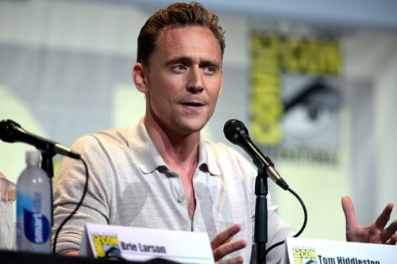
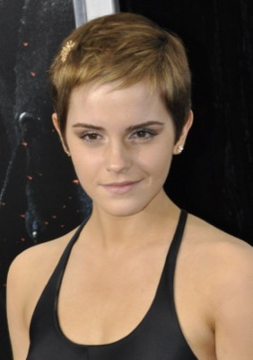
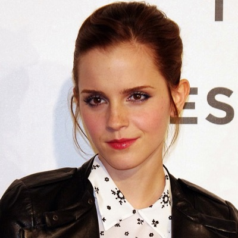
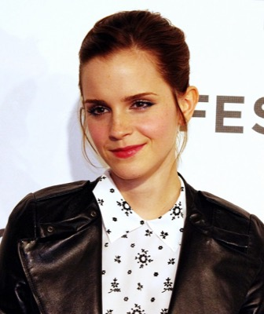
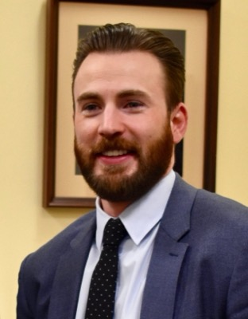
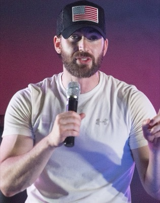

# facematch

Find a specific person, sort everyone, or clean up duplicates — across a
giant, messy photo/video archive (phone backups, cloud takeouts, old external
drives) — without scrolling through any of it by hand.

**`find`** takes a few reference photos of someone and a path, then streams
through everything under that path (folders, zip files, even zips nested
inside zips) and copies out every match. **`group`** does the same detection
work with no references at all, sorting every face it finds into per-person
folders. **`dedupe`** cleans up the result (or any folder you point it at) by
collapsing exact and near-duplicate copies — and runs automatically after
both of the above. Everything runs entirely on your machine: nothing is
uploaded anywhere.

```bash
uv run facematch build-references
uv run facematch find --sources ~/Photos ~/old-icloud-export.zip
```

## Features

- **Three real capabilities**: `find` a specific person, `group` everyone by
  face with no references needed, and `dedupe` any folder of photos/videos —
  standalone, or automatically after `find`/`group`.
- **Streaming archive scan** — reads zip entries one at a time instead of
  extracting the whole archive first, so scanning a 200GB cloud export
  doesn't need 200GB of free disk space. Zips inside zips are handled the
  same way.
- **Resumable by default** — every processed file is checkpointed to a local
  SQLite database as it completes. Kill the scan, restart your machine,
  re-run the same command: it picks up exactly where it left off.
- **Parallel** — a pool of worker processes (CPU count − 1 by default) does
  the decoding, detection, and embedding, so it scales with cores.
- **Background jobs** — kick off a long scan, close the terminal, and check
  on it later:

  ```bash
  facematch find --background
  facematch find status --watch
  ```

- **Tuned for recall** — the match threshold defaults to the high-recall end
  of the typical range, on the assumption that missing a real match is worse
  than having to reject a few false positives by hand. Archive photos often
  span decades, with real changes in age and appearance and plenty of
  low-quality scans, so this matters more here than in a typical
  face-verification setup.
- **Dedupe, automatically or standalone** — the same photo often exists more
  than once across overlapping backups. `facematch dedupe` collapses exact
  and near-duplicate copies (by content hash and perceptual hash) in any
  folder you point it at — it runs on its own, or automatically after `find`
  and `group`, correctly deduping each `group` person-folder independently
  so a group photo shared by two people is never mistaken for a duplicate.
- **Fully local** — no network calls, no accounts, no telemetry. See
  [Privacy](#privacy).

- **Group by person, no references needed** — `facematch group` detects
  every face across an archive and clusters them into `person_001/`,
  `person_002/`, ... folders using face-embedding similarity alone. Faces
  that don't form a confident group land in `unclustered/` instead of being
  dropped, and a file with several people in it is placed in every relevant
  person's folder.

Not built yet: packaged binaries so you don't need a Python toolchain to run
this — see [Roadmap](#roadmap).

## Install

Requires [`uv`](https://docs.astral.sh/uv/) and Python 3.11+.

```bash
git clone <this repo>
cd facematch
uv sync
```

`uv sync` builds the workspace's two packages — `facematch-core` (the
engine) and `facematch-cli` (the `facematch` command) — into a local
virtualenv. Run the tool with `uv run facematch ...` from whichever
directory holds your `references/`, `matched/`, and configuration: every
command resolves its inputs and outputs relative to the current working
directory, so a given directory is a self-contained "project" for one
person's search.

Packaged, double-clickable binaries for macOS and Linux (no `uv`/Python
setup required) are planned but not available yet.

## Quickstart

**1. Give it some reference photos.** Create a `references/` folder and drop
in a handful of clear photos (and optionally a short video) of the person
you're looking for.

```bash
mkdir references
cp ~/some-clear-photos-of-them/*.jpg references/
```

`references/` is gitignored: it holds real photos of a real person and
should never end up in version control.

<details>
<summary><strong>Pro tips for good reference photos</strong> (click to expand)</summary>

Reference quality matters more than the matching algorithm. A few minutes
here saves a lot of threshold-tuning later:

- **5–15 photos is the sweet spot.** Fewer than 5 and the embeddings get
  noisy; past ~20 you're mostly adding redundancy, not signal. Spend extra
  references on *diversity*, not near-duplicates of the same shot.
- **Cover different eras if the archive spans decades.** A face changes more
  than people expect — one reference from one era will under-match photos
  from 20+ years earlier or later. `find`'s default threshold is already
  tuned for this kind of recall, but diverse references still help far more
  than a lower threshold does.
- **Vary angle** (mostly front-facing and slight 3/4 views — avoid pure
  profile shots), **lighting** (indoor, outdoor, flash, overcast), and
  **styling** (with/without glasses, different hair, expressions). Boring,
  varied snapshots beat a handful of flattering portraits.
- **One clear face per photo.** `build-references` embeds the *largest*
  detected face in each file — if your target isn't the biggest face in a
  group photo, it'll silently embed the wrong person. Crop or pick
  single-subject shots.
- **Avoid heavy occlusion** (sunglasses, masks, shading hats) and **heavy
  filters/edits** — both distort the exact geometry the model keys on. A
  couple of occluded shots are fine; don't make them the majority.
- **A short video is worth including.** `build-references` samples several
  frames from it, so one clip gives you multiple naturally-varied references
  for the price of one file.

Before running a full archive scan, sanity-check the reference set cheaply —
`references/` should match itself near-perfectly, so this catches a bad
reference (wrong face, wrong person) before it pollutes a real scan:

```bash
uv run facematch build-references
uv run facematch find --sources references --limit 10
```

</details>

**2. Build embeddings from them:**

```bash
uv run facematch build-references
```

This writes `reference_embeddings.npz`.

**3. Point it at an archive:**

```bash
uv run facematch find --sources ~/Photos ~/Downloads/icloud_export.zip
```

Matches land in `matched/`, get logged to `matched/matches.csv`, and are
tracked in `checkpoint.sqlite3` as the scan runs. Stop it anytime with
Ctrl-C — running the same command again resumes instead of starting over.
When the scan finishes, `matched/` is deduplicated automatically (the same
photo often exists more than once across overlapping backups) — pass
`--no-dedupe` if you'd rather see the raw output.

You can also point `find` at sources listed in a config file instead of
passing them as flags every time:

```bash
cp sources.example.json sources.local.json
# edit sources.local.json with your real paths — it's gitignored
uv run facematch find
```

**Don't know who's in the archive, or want everyone sorted, not just one
person?** Skip references entirely:

```bash
uv run facematch group --sources ~/Photos --out ~/Photos-by-person
```

This clusters every detected face by similarity and writes `person_001/`,
`person_002/`, ... folders under `--out`, plus an `unclustered/` folder for
faces that didn't form a confident group. Each folder is deduped
independently and automatically once grouping finishes.

**Already have a folder of photos with duplicates and don't need face
matching at all?** `dedupe` works standalone on any folder:

```bash
uv run facematch dedupe --source ~/some/messy/photos
```

Every flag, default, and example invocation is documented in the CLI
itself — this README won't repeat it:

```bash
uv run facematch find --help
uv run facematch group --help
uv run facematch dedupe --help
uv run facematch --help          # full list of commands
```

## How it works

1. **Reference embeddings.** Each reference photo/video goes through
   [InsightFace](https://github.com/deepinsight/insightface) (`buffalo_l` /
   ArcFace, via ONNX Runtime, CPU-only) to produce a 512-dimensional face
   embedding — a vector where visually similar faces land close together.
2. **Scan.** Every file under your source paths goes through the same
   detection + embedding step. Each detected face's embedding is compared
   against every reference embedding using cosine similarity.
3. **Threshold.** A face counts as a match if its best similarity score
   clears the configured threshold (`--threshold`, high-recall by default —
   see [Features](#features)).
4. **Checkpoint.** Whether a file matched, didn't match, or errored, the
   outcome is committed to `checkpoint.sqlite3` immediately, one file at a
   time — so a scan is safe to interrupt at any point and resume later
   without redoing work or double-copying matches.

## Demo

To show both commands working end-to-end without using anyone's private
photos, [`examples/`](examples/) has real photos of three actors — Tom
Hiddleston, Chris Evans, and Emma Watson — sourced entirely from [Wikimedia
Commons](https://commons.wikimedia.org) under licenses that permit reuse
(full credit in [`examples/attributions.json`](examples/attributions.json)).
The photos span genuinely different quality, lighting, angle, and era
(roughly 2010-2025), the same conditions a real personal archive has.

**`find`** — 4 Hiddleston photos build the reference embeddings; `find` then
scans an 18-photo archive containing 5 more Hiddleston photos (real matches)
plus 6 Evans and 7 Watson photos (true negatives):

<table>
<tr><td align="center" width="20%"><b>references/</b><br>(4 photos)</td>
<td align="center">→ <code>facematch find</code> on the 18-photo archive →</td></tr>
</table>

| Matched (5/5 real Hiddleston photos found) |
| --- |
|      |

All 5 real Hiddleston photos in the archive were found (similarity
0.59–0.77), and all 13 Evans/Watson photos were correctly rejected — the
highest false-positive score was 0.155, well under the 0.38 threshold. Full
scores in [`examples/results/find/matches.csv`](examples/results/find/matches.csv).

**`group`** — no reference photos at all, just the same 18-photo archive
clustered by face:

| `person_001` (all 7 Watson photos) | `person_002` (all 5 Hiddleston photos) | `person_003` (5/6 Evans photos) |
| --- | --- | --- |
|    |    |    |

Three people in, three clean clusters out — with one honest imperfection:
one Evans photo (a formal press-tour shot, different lighting/context than
his others) didn't merge into `person_003` and landed in `unclustered/`
instead of being lost or wrongly merged:



That's the min-cluster-size/threshold tradeoff described in `facematch group
--help` in practice — real clustering on real photos, not a cherry-picked
run.

## Commands

Each command is fully documented by its own `--help`, including realistic
example invocations — run `facematch <command> --help` for the complete
picture. This is just the map:

| Command | What it does |
|---|---|
| `facematch build-references` | Build `reference_embeddings.npz` from the photos/videos in `references/`. |
| `facematch find` | Scan your archive and copy out matches (deduping automatically when done). Supports `--background`, `find status`, and `find restart` for job control. |
| `facematch group` | Cluster every face in your archive by person, no references needed (deduping each person folder automatically when done). Supports the same `--background` / `status` / `restart` job control as `find`. |
| `facematch dedupe` | Collapse duplicate files (exact + perceptual hash) in any folder into one canonical copy each — standalone, or (via `--per-subfolder`) the automatic post-processing step behind `find`/`group`. |
| `facematch backfill-videos` | Copy full video files for matches that only have a saved thumbnail, without re-running detection. |

## Privacy

This tool exists to run face recognition against your own private photo and
video archive, so it's worth being explicit: **everything happens on your
machine.** There are no network calls, no accounts, and no telemetry. Source
files are only ever read and copied, never modified or deleted. The engine
(`packages/core`) is a small, readable Python package if you want to verify
any of that yourself rather than take it on faith.

## Project layout

A `uv` workspace with two packages, split so a future GUI can reuse the same
engine without duplicating any matching logic:

- **`packages/core`** (`facematch-core`) — the engine: model loading,
  image/video decoding, embedding and matching, archive walking, and
  checkpointing. No CLI or UI code lives here.
- **`packages/cli`** (`facematch-cli`) — the `facematch` command, a thin
  front end over `facematch-core`.

## Roadmap

- Packaged, signed binaries for macOS and Linux, so running this doesn't
  require a Python toolchain.

## Contributing

Issues and pull requests are welcome. There's no formal contributing guide
yet — for anything beyond a small fix, open an issue first to talk through
the approach.

## License

[MIT](LICENSE)
